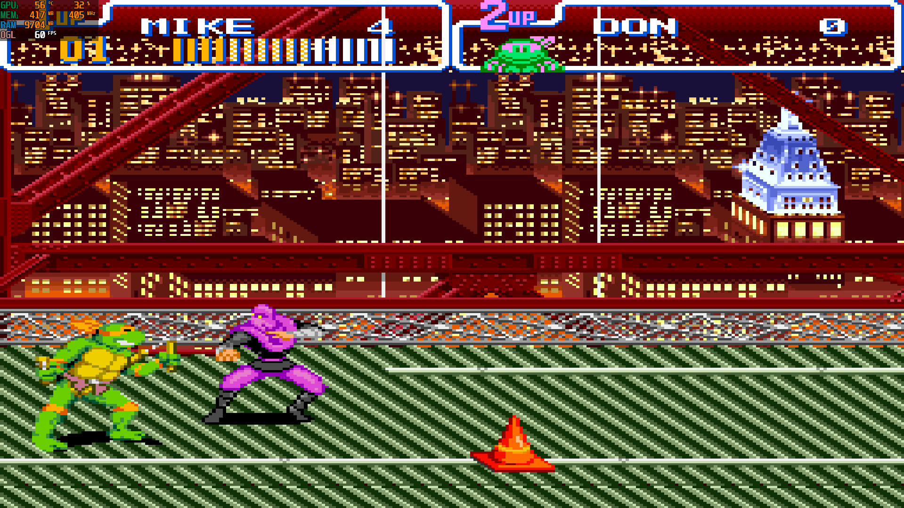
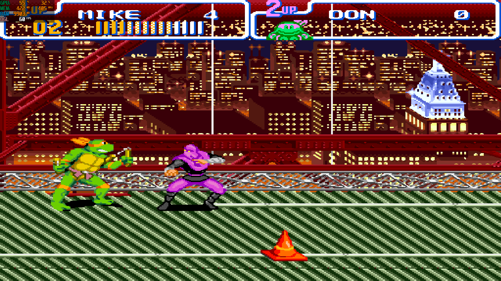

# TMNT IV: Turtles in Time — PC Recomp

[**🇧🇷 Português**](README.md) | [**🇺🇸 English**](README.en.md)

<div align="center">


**O clássico do Super Nintendo, agora jogável no Windows.**


</div>

Port para Windows de **Teenage Mutant Ninja Turtles IV: Turtles in Time** (SNES, versão USA), desenvolvido com o [SNESRecomp](https://github.com/emanuelcnjunior/snesrecomp-tmnt4). Oferece jogo local para até **dois jogadores** e um instalador para Windows com validação da ROM.

> **A ROM não está incluída.** Você deve fornecer sua própria cópia da versão USA compatível. O projeto não é afiliado à Konami, Nintendo ou aos detentores dos direitos de Teenage Mutant Ninja Turtles.

## ⬇️ Baixar e instalar

**[Baixar o instalador para Windows — v1.0.2](https://github.com/emanuelcnjunior/TMNT-IV-Turtles-in-Time-PC-Recomp/releases/download/v1.0.2/TMNT-IV-Turtles-in-Time-PC-Setup-v1.0.2.exe)**

**Requisitos:** Windows 10 (1903+) ou mais recente, **64 bits**, driver gráfico compatível com OpenGL e uma ROM USA válida. Para instalar e jogar, não é necessário instalar Git, Python, Rust, CMake ou Visual Studio.

1. Baixe e execute o instalador.
2. Quando solicitado, selecione **sua própria ROM USA** do jogo.
3. O instalador verifica o arquivo e o importa para a pasta de dados do usuário.
4. Abra o jogo pelo atalho criado e ajuste vídeo, áudio e controles no launcher.

O nome de origem do arquivo pode ser diferente: **o conteúdo é verificado por SHA-256**, e uma cópia válida é armazenada com o nome padronizado. ROMs de outras regiões, modificadas ou com cabeçalho de copiador não são aceitas.

[Releases anteriores](https://github.com/emanuelcnjunior/TMNT-IV-Turtles-in-Time-PC-Recomp/releases) · [Notas e checksums da v1.0.2](installer/RELEASE-v1.0.2.md) · [Guia detalhado do instalador](installer/README.md)

## 🎨 Galeria promocional

As artes a seguir foram criadas para apresentar o projeto. **São ilustrações promocionais, não capturas do jogo nem exemplos do filtro HD.** As imagens reais de gameplay aparecem na comparação dos modos Clássico e HD abaixo.

| Viagem no tempo | Ação pelas eras |
|:---:|:---:|
|  |  |

## 🎮 Controles e recursos

| Ação | Teclado | Controle |
|---|---|---|
| Salvamento rápido (Quick Save) | **F1** | **LT / L2** |
| Carregamento rápido (Quick Load) | **F2** | **RT / R2** |
| Lista de saves | **F11** | Consulte o mapeamento no launcher |
| Alternar Original / HD | **F6** | **Start** (também mantém a função Start do jogo) |
| Configurações gráficas | **F10** | Via interface |
| Abrir o launcher | **Ctrl + L** | — |

Os atalhos do teclado podem ser configurados em **Settings > Hotkeys**. Os comandos disponíveis podem depender da configuração do controle.

### 💾 Save Game

O port dispõe de **cinco slots manuais** e **um Quick Save**. São *save states* (fotografias do estado de execução), não saves nativos em SRAM do cartucho.

Os arquivos ficam em:

```text
%LOCALAPPDATA%\TMNTIVRecomp\saves\
```

Os estados possuem verificações de integridade e compatibilidade. **Uma atualização do runtime pode tornar saves antigos incompatíveis**; faça backup antes de atualizar. Consulte o [relatório técnico de saves](SAVE-GAME-REPORT.md) e a [auditoria da interface](SAVE-UI-AUDIT.md) para os testes e limitações.

### 🖼️ Modo Clássico e modo HD

| Modo Clássico | Modo HD (Scale2x) |
|:---:|:---:|
|  |  |

As capturas de gameplay mostram a mesma fase do jogo com duas apresentações visuais selecionáveis, **sem alterar personagens, colisões ou a jogabilidade original**:

- **Clássico / Original:** mantém os pixels e a estética do SNES, ideal para jogar com a apresentação tradicional.
- **HD:** utiliza escalonamento e filtros gráficos na GPU. O filtro **Scale2x** suaviza determinados contornos dos pixels, mas não substitui por si só os sprites ou cenários por arte redesenhada.
- **Alternância imediata:** pressione **F6** no teclado ou **Start** no controle; o Start também continua funcionando dentro do jogo.

#### Menu de configurações gráficas (F10)


O menu exibido nas capturas apresenta opções para **Modo Original/HD**, **Filtro (Scale2x)**, **resolução de saída** (por exemplo, 1920 × 1080), **escala**, **proporção 4:3**, **VSync**, **tela cheia**, **HD Pack**, **recarregamento** e **diagnóstico de IDs**.

- **4:3:** mantém a proporção tradicional do SNES.
- **WIDE FILL / PREENCHER:** estende a imagem para preencher 16:9; pode causar distorção horizontal. Desative para manter 4:3.
- **HD Pack:** a função depende de um pacote externo compatível. A mensagem **“MANIFESTO AUSENTE / MISSING MANIFEST”**, visível na captura, indica que **nenhum manifesto de pacote HD foi encontrado**; não é um erro necessário para usar Original ou Scale2x.
- **Diagnóstico / IDs:** ferramenta de desenvolvimento para mapear recursos gráficos.

**Importante:** o modo HD atual é um aprimoramento de apresentação/upscale, **não uma remasterização completa das texturas, sprites e backgrounds**. Pacotes opcionais precisam usar arte autoral ou devidamente licenciada.

### 💾 Tela de Save States


A captura da interface mostra uma lista visual de **seis posições: cinco slots manuais e um Quick Save**, com miniatura do jogo, data/hora e indicação de slots vazios (**NEW SLOT**). A navegação foi projetada para teclado e controles.

- **F11:** abre a lista de save states.
- **Setas / direcional:** selecionam o slot.
- **X (teclado) ou botão A (controle):** carrega o slot selecionado.
- **S (teclado) ou botão X (controle):** salva no slot selecionado, conforme as instruções exibidas na tela.
- **Esc (teclado) ou botão B (controle):** volta ao jogo.
- **F1 / LT-L2** e **F2 / RT-R2:** acesso rápido a salvar e carregar, respectivamente.

Os saves ficam em `%LOCALAPPDATA%\\TMNTIVRecomp\\saves\\`. Slots incompatíveis com alterações de formato/runtime podem não carregar; mantenha backup antes de atualizar.

## ✅ Estado e testes

O instalador e a validação da ROM estão implementados. A documentação registra testes de instalação, importação, integridade e inicialização, além de testes específicos do sistema de save. **Isso não equivale à homologação de uma campanha completa em todas as máquinas.** Há verificações manuais e de integração pendentes descritas nos relatórios.

- [Testes do instalador](installer/TEST-RESULTS.md)
- [Relatório de Save Game](SAVE-GAME-REPORT.md)
- [Notas da versão 1.0.2](installer/RELEASE-v1.0.2.md)

Encontrou um defeito? Abra uma [issue](https://github.com/emanuelcnjunior/TMNT-IV-Turtles-in-Time-PC-Recomp/issues) informando a versão, o Windows, os passos para reproduzir e, se possível, um log **sem anexar ROMs ou dados extraídos do jogo**.

## 🧩 ROM compatível

| Propriedade | Valor |
|---|---|
| Jogo | Teenage Mutant Ninja Turtles IV: Turtles in Time |
| Região | USA / North America |
| Formato | LoROM, `.sfc`, sem cabeçalho |
| Nome de destino | `Teenage Mutant Ninja Turtles IV - Turtles in Time (USA).sfc` |
| Tamanho | 1.048.576 bytes |
| CRC32 | `5940BD99` |
| SHA-256 | `5b82cdd6f2da56f43680d6a5021faebe2e06036d30602c1a7917aa414cf8b5f4` |

A ROM validada é armazenada em `%LOCALAPPDATA%\TMNTIVRecomp\`. A desinstalação preserva essa pasta, incluindo configurações e saves. Excluí-la manualmente **apaga também a cópia importada da ROM**.

## 🛠️ Compilar a partir do código-fonte

O caminho abaixo é para **desenvolvedores**, não para quem usa o instalador. Exige as ferramentas de build descritas no [guia de instalação](installer/README.md) e uma ROM compatível obtida pelo próprio desenvolvedor.

```bash
git clone --recurse-submodules https://github.com/emanuelcnjunior/TMNT-IV-Turtles-in-Time-PC-Recomp.git
cd TMNT-IV-Turtles-in-Time-PC-Recomp
bash tools/regen.sh --rom "/c/caminho/para/sua-rom-usa.sfc"
cmake -S . -B build -DCMAKE_BUILD_TYPE=Release
cmake --build build --parallel 4
```

O comando acima utiliza um shell Bash para a regeneração; no Windows, compile em ambiente configurado com MSVC/CMake. O código gerado em `src/gen/` não é versionado, e **a ROM nunca deve ser incluída em commits**.

Para gerar o instalador, consulte [installer/README.md](installer/README.md). O projeto principal usa os submódulos [snesrecomp-tmnt4](https://github.com/emanuelcnjunior/snesrecomp-tmnt4) e [recomp-ui](https://github.com/emanuelcnjunior/recomp-ui).

### Estrutura principal

| Diretório / arquivo | Descrição |
|---|---|
| `src/` | Código do port e integração com o host |
| `recomp/` | Configuração e símbolos da recompilação |
| `src/gen/` | Código gerado localmente a partir da ROM (não versionado) |
| `snesrecomp/` | Framework SNESRecomp (submódulo) |
| `recomp-ui/` | Launcher (submódulo) |
| `installer/` | Scripts, instruções e testes do instalador |
| `tools/regen.sh` | Verificação da ROM e geração do código |
| `rom_identity.txt` | Identidade da ROM aceita |

## 📄 Licença e direitos

O código próprio do projeto segue [LICENSE](LICENSE). Dependências e submódulos possuem licenças próprias. **A licença do código não concede direitos sobre o jogo original, seus personagens, áudio, sprites ou ROM.** Nenhuma ROM é oferecida aqui.
